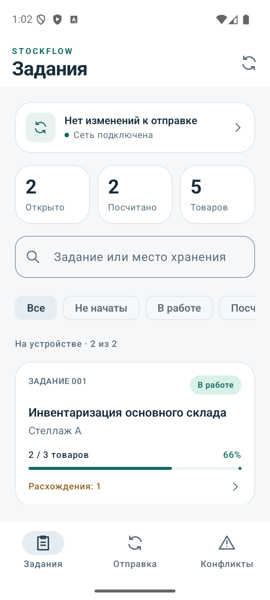
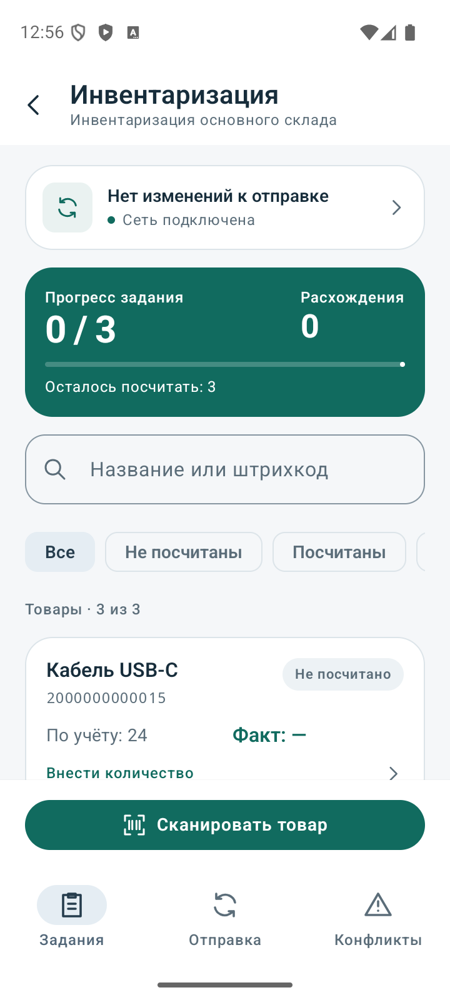
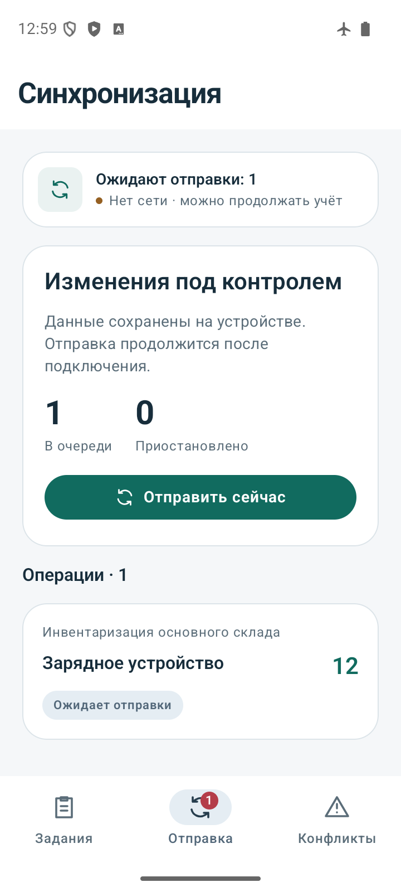
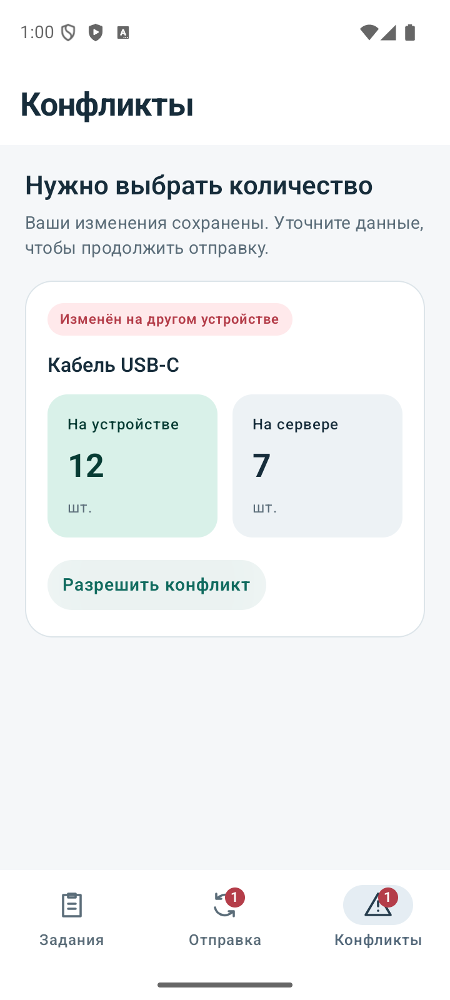

# StockFlow — Offline Inventory

Нативное Android-приложение для инвентаризации при нестабильной связи. Сотрудник получает задание, находит товар по штрихкоду и вводит фактическое количество. Результат сохраняется на устройстве и отправляется серверу, когда доступны сеть и фоновая работа. Одновременные изменения одного товара требуют явного решения пользователя.

Самостоятельный проект с учебными данными и локальным REST backend в репозитории. Основные инженерные задачи — сохранность офлайн-изменений, безопасный повтор запросов и восстановление после ошибок.

<p>
  
  
</p>
<p>
  
  
</p>

[Сценарий и решения для портфолио](docs/portfolio-case.md) · [Архитектура](docs/architecture.md) · [Проверки](docs/verification.md) · [Все скриншоты](docs/screenshots)

## Возможности

- Задания с прогрессом, поиском и фильтрами. Внутри задания — список товаров с учётным и фактическим количеством.
- Подсчёт без интернета: `0` означает отсутствие товара, `null` — товар ещё не проверен. Сохранённые данные переживают завершение процесса; черновик редактора — поворот экрана.
- Поиск штрихкода камерой CameraX/ML Kit или ручным вводом. Отказ в разрешении камеры оставляет ручной способ доступным; модель распознавания включена в APK.
- Экран отправки с настоящей очередью, причинами ошибок и ручной повторной попыткой.
- Отдельные экраны конфликтов: «Оставить моё» и «Принять серверное». Для постоянно отклонённой операции есть подтверждаемая отмена изменений выбранного товара с получением свежих данных сервера.
- Сохранение вкладок и вложенной навигации, светлая и тёмная темы.

## Как обеспечивается сохранность данных

| Ситуация | Решение |
| --- | --- |
| Процесс завершился во время сохранения | Количество и запись очереди сохраняются одной транзакцией Room: вместе или с откатом |
| Сервер применил изменение, но ответ потерялся | Повтор использует прежние UUID и payload; сервер возвращает сохранённое подтверждение |
| Другой клиент успел изменить товар | Проверка серверной версии возвращает конфликт вместо молчаливой перезаписи |
| Ответ повреждён или сервер временно недоступен | Операция и причина ошибки остаются в базе; отправка повторяется позже |
| Первая операция окончательно отклонена | Пользователь может подтвердить отмену изменений только этого товара; сбой проверки сервера сохраняет локальные данные |
| Процесс завершился между записью и планированием | Запуск приложения и периодическая работа повторно инициируют обработку очереди |

WorkManager учитывает ограничения Android и доступность сети. Точное время доставки не гарантируется. [Протокол, порядок операций и компромиссы](docs/architecture.md).

## Стек и устройство проекта

**Kotlin · Jetpack Compose · Material 3 · Navigation Compose · Coroutines/StateFlow · Room · Hilt · Retrofit/OkHttp · WorkManager · CameraX · ML Kit · JUnit**

Один Gradle-модуль `app` с разделением по ответственности:

```text
presentation/  Compose-экраны, навигация и ViewModel
domain/        Модели, правила и интерфейсы
data/          Room, HTTP, очередь и синхронизация
di/            Сборка зависимостей через Hilt
```

UI читает локальное состояние через Flow из Room. Команды проходят через ViewModel и repository; SyncEngine отправляет сохранённые операции через API. Room имеет миграции 1 → 2 → 3. Backend использует Python и SQLite без внешних библиотек.

## Быстрый запуск

Нужны Android Studio, JDK 17–23, Android SDK 36 и Python 3.10+. Локальная проверка выполнена с JDK 22. Минимальная версия устройства — Android 8.0 / API 26.

1. Откройте проект в Android Studio, дождитесь Gradle Sync и запустите Android Emulator. IDE создаёт `local.properties` с локальным путём к SDK. Для первой сборки нужен доступ к Google Maven и Maven Central.
2. Из корня проекта запустите backend в отдельном терминале и оставьте его работающим:

   ```sh
   python3 backend/server.py --database stockflow-demo.sqlite3
   ```

3. Нажмите **Run** в Android Studio. Для установки через терминал:

   ```sh
   ./gradlew :app:installDebug
   ```

   После установки откройте StockFlow на эмуляторе. Собранный APK: `app/build/outputs/apk/debug/app-debug.apk`.

4. Нажмите **«Загрузить задания»**: появятся два задания и пять учебных товаров. Без backend можно выбрать **«Создать демо-задание»** для знакомства с локальным учётом; отправка требует работающего сервера.

Debug URL по умолчанию — `http://10.0.2.2:8080/`: адрес компьютера из стандартного Android Emulator. Backend занимает порт 8080; SQLite-файл сохраняет данные между запусками и исключён из Git.

Для физического устройства запустите тот же backend, подключите устройство с разрешённой USB-отладкой и выполните:

```sh
adb reverse tcp:8080 tcp:8080
./gradlew :app:installDebug -Pstockflow.debugApiBaseUrl=http://127.0.0.1:8080/
```

Эти команды рассчитаны на одно подключённое устройство. [API и настройка backend](backend/README.md).

## Демонстрация за несколько минут

1. Откройте задание, сохраните `0` и проверьте прогресс подсчёта.
2. Отключите сеть, измените количество другого товара и откройте «Отправку»: операция сохранена. Перезапустите приложение, верните сеть и дождитесь подтверждения.
3. Найдите `2000000000015` ручным вводом штрихкода. Неизвестный код не выбирает произвольный товар.
4. Воспроизведите [конфликт двух устройств или изменение через curl](backend/README.md#конфликт-двух-устройств) и проверьте оба решения.
5. Перезапустите backend с `--drop-first-response`, затем измените количество: запрос повторится, а эффект будет применён один раз. [Режимы сетевых сбоев](backend/README.md#воспроизводимые-сетевые-сбои).

## Проверки

Подтверждённые результаты на **5 ноября 2026**, Pixel 9 Emulator / Android 16 / API 36:

| Проверка | Результат |
| --- | --- |
| Debug APK и тестовый APK | Собраны |
| JVM-тесты | 49, без ошибок |
| Android-тесты | 35, без ошибок |
| Backend | 16, без ошибок |
| SQL миграций / скрипт проверки | 3 / 9, без ошибок |
| Lint | 0 ошибок, 27 предупреждений |
| Полный UI smoke с потерянным ответом | PASS |

Тесты покрывают транзакции, миграции, повторы, конфликты, повреждённый HTTP-ответ, восстановление отклонённой записи, навигацию и управление камерой. Smoke проходит через APK и локальный backend: offline/restart, потерянный ответ, оба решения конфликтов и открытие/освобождение камеры. [Команды, результаты и границы проверки](docs/verification.md). [Исправления по результатам ревью](docs/review-fixes.md).

Полный запуск с уже включённым эмулятором или авторизованным устройством:

```sh
bash scripts/verify_android.sh --connected
```

Без устройства уберите `--connected`; при нескольких устройствах задайте `ANDROID_SERIAL`. Логи, APK и отчёты сохраняются в `build/verification/run-*`. Для UI smoke нужен выделенный эмулятор: сценарий очищает данные приложения, требует `--reset-app` и свободный порт 8080.

[GitHub Actions](.github/workflows/android.yml) настроен на сборку, JVM/lint/backend/SQL и Android-тесты на API 26/36 с сохранением артефактов. Удалённый запуск CI пока не подтверждён; локально проверен API 36.

## Текущие ограничения

- Общая FIFO-очередь: конфликт первой операции задерживает отправку остальных. Локальный подсчёт других товаров остаётся доступным.
- Нет авторизации, разделения пользователей и общего протокола серверных удалений каталога. Backend предназначен для локальной разработки.
- Проверены эмулятор и распознавание подготовленного изображения. Физические камеры и разные модели устройств требуют отдельной проверки.
- Release endpoint — заглушка `https://stockflow.invalid/`; production-инфраструктура и release-подпись не настроены. Настоящий HTTPS URL задаётся через `-Pstockflow.releaseApiBaseUrl=https://your-server.example/`.
