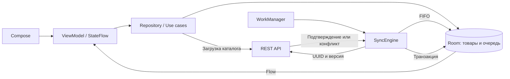

# Архитектурные решения StockFlow

## Один Gradle-модуль

Статус: принято для первого этапа.

`app` содержит пакеты `presentation`, `domain`, `data`, `di`. UI и хранение зависят от контрактов domain, а Hilt связывает реализации. Это позволяет начать с Compose и offline-first без поддержки нескольких Gradle-модулей. Цена решения: границы пакетов проверяются ревью, а не компилятором.

Выделение `core:database`, `core:network` и `feature:inventory` имеет смысл после появления независимых features, потребности в повторном использовании или измеримых проблем со временем сборки.

## Room как источник локального состояния

UI читает Flow из Room через WorkspaceViewModel и собирает состояние с учётом lifecycle. Черновик количества и ID редактируемого товара живут в `SavedStateHandle`; навигацию сохраняет Navigation Compose, запросы поиска и фильтры — `rememberSaveable`. Завершение сохранения обновляет состояние редактора во ViewModel и не зависит от callback старой композиции после поворота. `null` означает «не посчитано», `0` — фактическое отсутствие товара.

Сохранение не требует сервера. Изменение количества и вставка `pending_operations` выполняются одной транзакцией. Если вставка операции не удалась, количество откатывается. У операции есть постоянный случайный UUID и снимок количества на момент изменения.

## Навигация и модели чтения

Три вкладки: задания, отправка, конфликты. В графе заданий находится инвентаризация, в графе конфликтов — отдельный экран решения. Вложенный back stack сохраняется при переключении вкладок. Системная кнопка назад возвращает из инвентаризации к заданиям.

Прогресс и очередь — отдельные модели чтения Room. Подсчёт товаров и операций агрегируется в разных подзапросах перед соединением: несколько операций одного товара не умножают число товаров или расхождений. Состояния «не начато», «в работе», «посчитано» вычисляются по фактическому прогрессу, а не записываются в отдельный расходящийся флаг.

Экран синхронизации показывает только реальные неподтверждённые операции, количество неудачных попыток и сохранённые ошибки. История успешных отправок и время последней синхронизации не выдумываются: для них потребовалась бы отдельная долговечная модель. Сетевой индикатор использует ConnectivityManager и сообщает о подключении, а не о доступности сервера.

## Загрузка каталога

Пользователь явно обновляет задания через API. DTO преобразуются в валидированный каталог: проверяются ID, родительские задания, количества, версии и уникальность штрихкода внутри задания. Данные применяются транзакцией через upsert, без удаления родительских строк и каскадной потери товаров.

Метаданные обновляются, а неотправленное количество и известная базовая версия сохраняются. Ответ, начатый до успешной отправки, не может откатить более новую подтверждённую версию. Для чистого товара новое серверное количество становится локальным. Задания и товары, отсутствующие в ответе, пока не удаляются: для удаления нужны отдельные серверные tombstones и правила работы с локальными операциями.

## Версии, последовательность и идемпотентность

Очередь отправляется по локальному возрастающему `sequence`. Перед первым запросом базовая версия товара фиксируется в операции транзакцией Room. Повтор использует те же UUID, товар, количество и базовую версию. Поздняя загрузка каталога не меняет уже зафиксированный payload.

Сервер принимает изменение только при совпадении базовой и текущей версий, увеличивает версию и в одной транзакции сохраняет количество и подтверждение UUID. Повтор возвращает первоначальное подтверждение, даже если затем другой клиент уже изменил товар. Сервер сначала проверяет UUID, а затем версию; иначе потерянный ответ ошибочно превратился бы в конфликт.

Локальное подтверждение обновляет известную серверную версию и удаляет только конкретный UUID. Оно не меняет фактическое количество: более позднее локальное редактирование остаётся в силе. Следующая операция этого товара получает версию из подтверждения предыдущей.

Доставка выполняется с повторениями; exactly-once доставка через сеть не заявляется. Идемпотентный эффект требует долговечного серверного журнала. Клиент проверяет количество и версию в подтверждении до удаления операции.

## Разрешение конфликтов

При HTTP `409` с `reason: revision_conflict` очередь сохраняет серверное количество и версию. UI показывает конфликт с **последним локальным** количеством. Новые правки этого товара блокируются на уровне репозитория, остальные товары доступны для локального учёта.

- **Оставить моё:** повторно получить серверную версию; транзакцией удалить прежние операции этого товара, сохранить последнее локальное количество и создать новую операцию с новым UUID и свежей базовой версией.
- **Принять серверное:** повторно получить последнее серверное состояние; транзакцией заменить локальное количество и удалить только операции этого товара.

Обе операции проверяют, что исходный конфликт всё ещё существует. Ошибка сети оставляет данные и очередь без изменений. Новое серверное изменение после чтения версии вызывает новый конфликт при отправке. Другие товары не затрагиваются.

`idempotency_conflict` — отдельная ошибка нарушения ключа: она не выдаётся за бизнес-конфликт и не получает автоматический новый UUID. Обычная кнопка повтора не сбрасывает бизнес-конфликт без выбора пользователя.

## Восстановление после постоянного отклонения

В карточке отклонённой операции доступна команда «Отменить изменения товара». Диалог явно предупреждает: отменяются все локальные неотправленные изменения выбранного товара, данные других товаров сохраняются. Без подтверждения запись не удаляется.

Repository получает актуальное состояние сервера вне транзакции. Затем повторно проверяет, что исходная операция всё ещё заблокирована без бизнес-конфликта и не изменилась за время HTTP. В одной транзакции удаляются операции этого товара и восстанавливается серверное количество/ревизия. Подтверждённый HTTP 404 позволяет удалить отсутствующий товар с устройства. Сетевые ошибки, 5xx и ошибки формата не трактуются как отсутствие товара и сохраняют локальную работу. Это явное восстановление выбранной записи, а не общий протокол серверных удалений каталога.

Во время восстановления UI блокирует повторное действие и ручной retry. Ошибка записи откатывает удаление очереди. После успешного восстановления планируется отправка оставшихся товаров.

## Ошибки чтения UI

Экран деталей конфликта различает загрузку, ошибку чтения и подтверждённое отсутствие конфликта. При ошибке показывается повтор чтения, а не сообщение «Конфликт уже разрешён». В debug-сборке причины ошибок ViewModel/локальных наблюдений записываются в диагностику; технические исключения не подменяют пользовательское сообщение.

## WorkManager и восстановление

`NetworkType.CONNECTED` не гарантирует доступность сервера. `IOException`, ошибки декодирования JSON, некорректное подтверждение HTTP `200`, HTTP `408`, `425`, `429` и `5xx` сохраняют операцию и причину ошибки, затем возвращают retry с экспоненциальной задержкой WorkManager. Успешный контракт — HTTP `200` с проверенным количеством и версией. Повтор после повреждённого ответа использует прежний UUID и payload: сервер мог уже выполнить commit. Постоянные отклонения приостанавливают очередь.

Фоновые одноразовые задачи добавляются в уникальную цепочку через `APPEND_OR_REPLACE`, чтобы не потерять запрос на запуск, пока предыдущий worker заканчивает работу. Явная команда «Отправить сейчас» использует `REPLACE`: ожидающая retry-цепочка отменяется, новая попытка не зависит от её backoff. Singleton Mutex не позволяет двум потребителям одновременно отправлять очередь; UUID защищает повтор, если отменённый HTTP-запрос успел примениться на сервере. Ограничения Android и требование сети сохраняются. Периодическая задача с интервалом 15 минут восстанавливает отправку после завершения процесса между commit и enqueue. Запуск приложения также инициирует отправку. ОС может отложить работу из-за Doze, батареи и сети; после принудительной остановки пользователем потребуется открытие приложения.

Периодическая задача и одноразовая цепочка могут пересечься. Singleton `SyncEngine` сериализует их через `Mutex`. Приложение однопроцессное; межпроцессных lease нет. Worker обрабатывает до 100 операций за попытку. Отмена пробрасывается, неподтверждённая операция остаётся в Room.

## Сканирование

CameraX Preview и ImageAnalysis привязаны к lifecycle. Анализ использует `STRATEGY_KEEP_ONLY_LATEST`; `ImageProxy` закрывается после завершения ML Kit, включая ошибки. При закрытии экрана освобождаются use cases, observer, scanner и executor. Отложенное получение CameraProvider проверяет, что экран ещё открыт.

Bundled ML Kit включает модель в приложение, поэтому распознавание не требует первичной загрузки через сеть. Поиск выполняется по точному коду в открытом задании с сохранением ведущих нулей. Неизвестный или неоднозначный код не выбирает произвольный товар. Повтор одного кода ограничен, после успешного выбора сканер закрывается и открывается ввод количества.

Разрешение камеры запрашивается по действию пользователя. При отказе, отсутствии камеры или ошибке распознавания доступен ручной ввод. Камера необязательна для установки приложения.

## Миграции и ограничения

- Версия Room 1 → 2 создаёт очередь и ставит в неё старые посчитанные количества, включая ноль.
- Версия 2 → 3 добавляет серверную версию товара, фиксируемую версию запроса и данные конфликта. UUID, попытки и блокировки сохраняются. Старые локальные значения консервативно начинают с версии `0` и при необходимости проходят через разрешение конфликта.
- Схемы Room должны быть экспортированы и добавлены в Git после первой успешной Android-сборки. Деструктивных миграций нет.
- FIFO общий: конфликт головы приостанавливает отправку остальных товаров. Независимые очереди по товару можно добавить позднее.
- Нет авторизации, распределённой серверной БД, удалений каталога и бесконечной истории версий.
- HTTP разрешён только debug-варианту для локального backend. Release требует настоящего HTTPS endpoint вместо заглушки.
- kapt используется для Room и Hilt. Переход на KSP должен быть отдельным проверяемым изменением.
- Debug и test APK собраны с генерацией Room/Hilt, 49 JVM-тестов и 35 Android-тестов прошли на API 36. Через настоящий UI проверены offline/restart, потерянный ответ, оба решения конфликта, камера и её освобождение. Физические устройства и API 26 пока не проверялись локально; подробности находятся в [отчёте проверки](verification.md).

Документация: [CameraX ImageAnalysis](https://developer.android.com/media/camera/camerax/analyze), [ML Kit barcode scanning](https://developers.google.com/ml-kit/vision/barcode-scanning/android).
